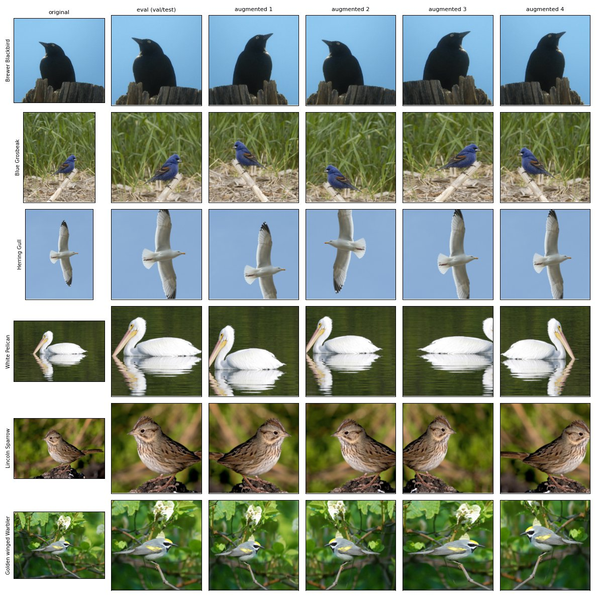
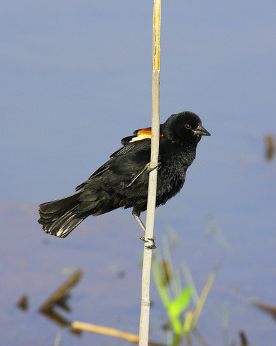

# Data and preprocessing — Artem, 10 November 2026

## Report section

We study single-label classification of all 200 bird species in CUB-200-2011
(11,788 images). The dataset contains images of varying dimensions and eight grayscale
images, so all inputs are converted to RGB. We preserve the official 5,794-image test set
and construct validation from the official training set. Before sampling, duplicate
filtering removes 42 training images, including 30 train copies of test photos. Five
images per species are then sampled for validation with seed 42, leaving 1,000 validation
images and a 4,952-image training pool (20–25 images per species). This maintains balanced
validation while retaining at least 20 training examples per species for a supplementary
20-shot reference. The removed images and final assignments are stored in versioned CSV files.

The primary experiment uses 10 real training images per species (2,000 per run).
For seeds 0, 1 and 2, saved within-species ranks define balanced subsets; all approaches
with the same seed receive exactly the same real images. The optional 5-, 10- and 20-shot
subsets are nested within each seed. Validation and test contain real images only and are
excluded from training, generation prompts and species-quality review. Held-out images
are used in a separate duplicate-exclusion check without consulting classifier scores.

All baseline inputs, real originals in the augmentation arms, synthetic images and
validation/test inputs share deterministic preprocessing: RGB conversion, aspect-ratio-
preserving resize to a 256-pixel shorter side, center crop to 224 × 224, and normalization
using fixed ImageNet mean (0.485, 0.456, 0.406) and standard deviation (0.229, 0.224, 0.225).
Standard augmentation adds one fixed random resized crop (50–100% image area, default
aspect-ratio range 3/4–4/3) with horizontal flip probability 0.5 per real image, producing
4,000 entries. A hash of image ID and run seed fixes each added view across accesses and
worker counts. The reviewed-synthetic arm adds 1,440 accepted generated images without
crop/flip variants, producing 3,440 entries. These images cover 185 species; 118 species
have fewer than 10 synthetic examples, including 15 with none. Thus real data remain
balanced, while synthetic augmentation introduces unequal per-species counts. All arms
use the same optimizer-step budget rather than the same number of epochs.

Leakage detection combines file MD5 equality and cosine similarity of ImageNet-pretrained
ResNet-18 embeddings with threshold 0.93. For real images, the embedding rule is applied
within species; synthetic-to-held-out checking ignores labels. Saved checks record no
remaining cross-split real duplicate matches and no held-out matches among the 1,440
reviewed images. Nineteen detected duplicate pairs within the official test set are retained
to preserve the benchmark. These checks reduce detected overlap but do not establish the
absence of all near duplicates or pretraining overlap. The exact manifests, class mapping,
source/input hashes and saved predictions support independent auditing of the experiments.

## Evidence for the section

| Claim | Repository evidence |
| --- | --- |
| Final assignments and sampling ranks | [`cub_splits.csv`](../splits/cub_splits.csv) |
| 42 removed training images | [`dropped_duplicates.csv`](../splits/dropped_duplicates.csv) |
| Split/subset IDs | [`manifests/`](../splits/manifests/) |
| Real duplicate checks | [`leakage_report.json`](../reports/leakage_report.json) |
| Synthetic counts and held-out checks | [`prepared pool report`](../reports/generation/prepared_sd15_wildlife_accepted/leakage_report.json) |
| Actual transforms and loaders | [`preprocessing.py`](../src/preprocessing.py) |
| Detailed split reasoning | [`data_split.md`](data_split.md) |
| Saved artifact audit and checkpoint replay | [`reproducibility.md`](reproducibility.md) |

## Preprocessing illustration and limitations

Each row shows a real training image, its deterministic evaluation crop and four example
random crop/flip views. These illustrate the transform distribution; the actual standard
training dataset retains just one image-ID/seed-derived view per source. Center crops can
trim tails or other distinguishing features, and a random crop can remove the bird's head.
No bounding-box crop is used. This is a plausible limitation for fine-grained classification,
not an established explanation of measured errors.

Absolute performance may also reflect overlap with backbone/generator pretraining data;
our audit cannot establish their training-set membership. Sharing a backbone controls one
experimental factor but does not eliminate this limitation. The historical EDA notebook used
an earlier 15% validation split; final counts come from the tracked manifests above.

## Individual test-failure analysis

**Case:** `validation/010.Red_winged_Blackbird/Red_Winged_Blackbird_0045_4526`,
true label 9 (`010.Red_winged_Blackbird`). This is one of the examples already selected
in the team's final evaluation; it is not a newly selected representative sample.

| Selected 10-shot approach | Seed 0 | Seed 1 | Seed 2 |
| --- | --- | --- | --- |
| Real-only | Red-winged Blackbird | Red-winged Blackbird | Red-winged Blackbird |
| Standard augmentation | Red-winged Blackbird | Red-winged Blackbird | Red-winged Blackbird |
| Reviewed synthetic | American Crow | American Crow | American Crow |

The entries were checked directly in the tracked compressed test CSVs. Standard seed 0
uses `archive/standard_aug_10shot_seed0_original`; seeds 1–2 use the T4 runs, following
`evaluation_selection.py`. Image source/hash and the original selected-example record are
in [the image provenance](../reports/evaluation_2026-11-03/failure_images/sources.json) and
[the failure table](../reports/evaluation_2026-11-03/test_failure_examples.csv).

**Visible evidence:** dark plumage dominates the image, a vertical reed occludes part of
the body, and the red/yellow shoulder marking occupies a small area. The 400 × 500 source
is resized to 256 × 320 and center-cropped to 224 × 224. This retains the central shoulder
marking but reduces its pixel area; it does not remove the marking outright. Thus both
occlusion and limited fine-detail resolution are plausible difficulties.

**Interpretation:** confusing this bird with a crow is consistent with relying on broad
dark-plumage features instead of the smaller shoulder cue. However, the real-only and
standard heads succeed on the same image with the same evaluation transform. Preprocessing
alone therefore cannot explain the synthetic regression. A changed classifier boundary
under synthetic training is observed; its cause is not isolated. Unequal synthetic class
coverage, domain differences and changed real-image exposure are hypotheses, not findings
from this single case. No saliency analysis or causal crop/occlusion experiment was performed.
