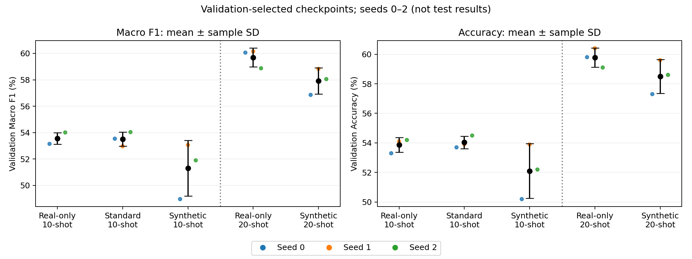
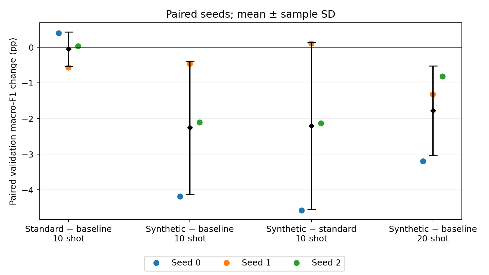

# Supporting notes for the final report and presentation — 10 November 2026

Prepared on 3 November. This document preserves supporting material moved out of the weekly evaluation report. These are results/status as of 3 November, not evidence of additional completed work or new mandatory experiments. The weekly report follows the supplied rubric: final test metrics, comparison, runtime and at least three failure examples.

**Selection update — 3 November:** following Karina's clarification, standard-augmentation seed 0 uses her complete validation/test/runtime bundle (`archive/standard_aug_10shot_seed0_original`, checkpoint SHA-256 `3d4d3a61…`). Seeds 1–2 use Artem's T4 runs. The seed-0 reruns use the same experimental protocol but different weights, hardware/software and recorded source versions. The complete bundle is selected for consistent reporting, not because its test metric is higher. The T4 seed-0 run remains available as an alternative; no repeat inference or retraining is required.

## Presentation material and optional follow-up

- Use the weekly report's test comparison, runtime table and three illustrated failure cases in the final presentation.
- Use the validation comparison below to explain checkpoint selection, keeping validation and test clearly separated.
- Use the literature review for context, without treating different backbones/data/training recipes as a controlled comparison.
- Explain why the 20-shot comparison changes both real-data quantity and the synthetic-to-real ratio. An equal-real-exposure or quality/quantity ablation would require a new controlled experiment; it is optional, not an experiment already performed.
- Keep detailed provenance/audit evidence available for questions rather than placing it all in the main results narrative.

## Completed work and readiness

| Owner | Work available for this milestone | Remaining dependency |
| --- | --- | --- |
| Karina | Real-only runs and test exports; supplied checkpoint/prediction archive, including standard augmentation seeds 1–2 | Provide original evaluation metadata if retained; no new run required |
| Artem | Offline reproducibility audit; CPU replay of all three standard-augmentation checkpoints; pinned replay dependencies | His available evidence does not cover baseline/synthetic checkpoint inference |
| Safina | Generation quality/cost records, synthetic 20-shot runs and test predictions/checkpoints for all six synthetic models | Supply original evaluation metadata |
| Arina | Audited 15 validation runs; recomputed 17 supplied test exports (15 selected + 2 historical); prepared test/validation comparisons, per-species analysis, runtime tables, figures and three failure examples | Evaluation complete; reuse tables and illustrated failures for the presentation |

Training and validation for the nine-run primary comparison are complete: real-only, standard augmentation and reviewed synthetic augmentation, each with seeds 0–2 and 2,000 real images (10 per species). Supplementary experiments now include both real-only and reviewed-synthetic 20-shot training, each across three seeds. No additional training is required to complete this 15-run comparison.

The new synthetic 20-shot runs use 4,000 real + 1,440 reviewed synthetic images, or 5,440 entries. Within each shot count, paired approaches share the real subset for each seed. All use an ImageNet-pretrained ResNet-18 with frozen backbone/BatchNorm, a trainable 200-class head, AdamW (learning rate 0.001, weight decay 0.0001), batch size 64 and 1,000 optimizer steps. Checkpoints maximize macro F1 on the same 1,000 real validation images, evaluated every 100 steps. Original real and synthetic images use resize-to-256/center-crop-to-224 and ImageNet normalization; standard augmentation adds one fixed crop/flip view per real image.

## Validation comparison

Mean ± sample standard deviation across seeds 0–2; pp means percentage points.

| Approach | Real images | Added entries | Macro F1 | Accuracy |
| --- | ---: | ---: | ---: | ---: |
| Real-only, 10-shot | 2,000 | 0 | 53.56% ± 0.43 pp | 53.87% ± 0.49 pp |
| Standard augmentation, 10-shot | 2,000 | 2,000 crop/flip views | 53.51% ± 0.54 pp | 54.03% ± 0.42 pp |
| Reviewed synthetic, 10-shot | 2,000 | 1,440 synthetic | 51.31% ± 2.11 pp | 52.10% ± 1.85 pp |
| Real-only, 20-shot | 4,000 | 0 | 59.69% ± 0.71 pp | 59.77% ± 0.65 pp |
| Reviewed synthetic, 20-shot | 4,000 | 1,440 synthetic | 57.91% ± 0.99 pp | 58.50% ± 1.15 pp |

Paired macro-F1 changes subtract the second approach from the first within the same seed and shot count:

| Comparison | Seed 0 | Seed 1 | Seed 2 | Mean ± sample SD |
| --- | ---: | ---: | ---: | ---: |
| Standard − real-only, 10-shot | +0.39 pp | -0.57 pp | +0.03 pp | -0.05 ± 0.48 pp (n=3) |
| Synthetic − real-only, 10-shot | −4.19 pp | −0.47 pp | −2.11 pp | −2.25 ± 1.86 pp |
| Synthetic − standard, 10-shot | -4.58 pp | +0.10 pp | -2.14 pp | -2.20 ± 2.34 pp (n=3) |
| Synthetic − real-only, 20-shot | −3.20 pp | −1.32 pp | −0.82 pp | −1.78 ± 1.25 pp |

Standard augmentation produces almost the same mean validation macro F1 as the matched 10-shot baseline. Reviewed synthetic augmentation scores below its matched real-only baseline in every tested seed at both shot counts. These observations do not support the expected improvement for this synthetic pool, fixed-feature classifier and training budget. Three seeds describe variability; they do not establish a general effect for diffusion augmentation.

At 20-shot, the mean synthetic penalty is smaller (−1.78 vs. −2.25 pp). This is not a controlled ratio experiment: the real-data count doubles while the synthetic-to-real ratio falls from 0.72:1 to 0.36:1. The results cannot attribute the difference to either factor alone. The full three-approach comparison remains 10-shot; no standard-augmentation 20-shot run was performed.

## Reproducibility and limitations

- Arina's saved source audit passes for the **original 15-run matrix (T4 standard seed 0)**, with zero errors: split/subset IDs, saved source/input hashes, class mappings, prediction-derived aggregate/per-class metrics and checkpoint selection from history agree. The original baseline seed-0 source is verified against its recorded historical Git snapshot. [Audit evidence](../reports/reproducibility_followup_2026-11-03.json).
- Artem reproduced **3,000/3,000** standard-augmentation validation predictions on CPU. Pinning Pillow 12.2.0 resolved five earlier prediction differences; loss differs by at most `1.38e-7`. This confirms those checkpoint replays, not full retraining or all other models. [Replay evidence](../docs/reproducibility.md).
- All 15 selected checkpoints are now available locally, including Safina's synthetic 20-shot files. Embedded configurations, selected steps and saved validation F1 match the validation artifacts. Standard seed 0 now selects `archive/standard_aug_10shot_seed0_original` as a complete bundle. Its validation metrics, per-class predictions and best-step history were checked again. The earlier source audit and Artem’s CPU replay still describe the T4 run, not Karina’s replacement; those checks are not claimed for the replacement source version. [Inventory](../reports/evaluation_2026-11-03/checkpoint_inventory.json).
- All 17 distinct submitted CSVs contain the exact 5,794 test IDs in manifest order, unchanged labels and a valid class mapping. Duplicate synthetic 10-shot submissions in the two archives are byte-identical. Original `evaluation_config.json`, metric JSONs and inference-environment records were not supplied. The scores above were independently recomputed; co-delivered weights and matching metadata do not independently prove that those weights/environment produced each CSV. No test inference was rerun locally, and loss/confidence cannot be recovered from hard labels. [Import evidence](../reports/test/import_provenance.json) and [test verification](../reports/evaluation_2026-11-03/test_verification.json).
- Validation selected checkpoints; test results are used for reporting only. Uneven synthetic counts, visual defects, domain differences and reduced real-image exposure under a fixed step budget remain possible explanations, not isolated causal findings. Controlled quantity, quality and diversity experiments remain optional.

## Literature context

The supplied literature draft has been updated against three primary papers in [cub_literature_comparison.md](cub_literature_comparison.md). Published frozen-feature and fine-tuned results provide context, but differences in backbone, training data, resolution and optimization prevent a controlled ranking. Interpolating validation learning curves does not establish that the synthetic deficit disappears at equal real-image exposure; that would require a separate controlled experiment. No model choices were changed in response to test scores.

## Additional per-species evidence

Full precision, recall, F1 and support are in [test_per_class.csv](../reports/evaluation_2026-11-03/test_per_class.csv); paired species-level F1 differences are in [test_species_changes.csv](../reports/evaluation_2026-11-03/test_species_changes.csv). The additional [paired test figure](../reports/evaluation_2026-11-03/test_paired.png) can be used in slides. Saved leakage checks report zero validation/test matches; this does not establish perfect synthetic species labels or independence from generator pretraining data.

## Handoff and submission checks

1. **Selection resolved:** standard seed 0 uses Karina’s full bundle; no new test export or retraining is required.
2. **Checkpoint owners:** provide existing evaluation configurations/commands and environment versions if recorded, so the original CSVs can be tied to their inference procedure. The absent aggregate metric JSON files do not block scoring because they have been recomputed.
3. **Arina:** test/validation comparisons, runtime tables and figures have been regenerated for the complete 15-run selection.
4. **Failure analysis is required this week:** the weekly report now contains three original photos, exact predictions and possible causes; reuse this material for the final presentation. Visual hypotheses must be distinguished from measured results.

The planned three-arm test comparison is **9/9 primary runs complete**, or **15/15 including supplementary runs**. All groups use seeds 0–2.
