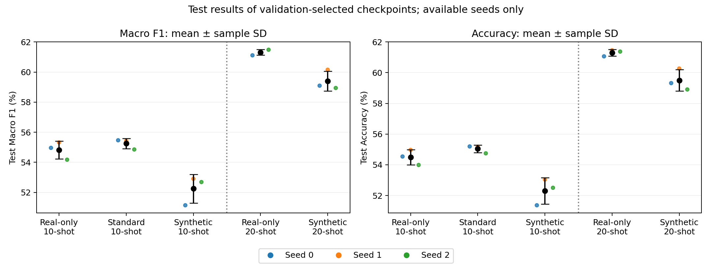
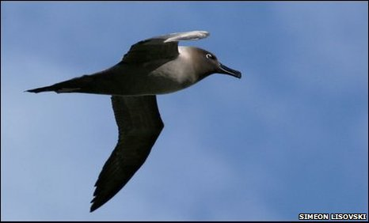
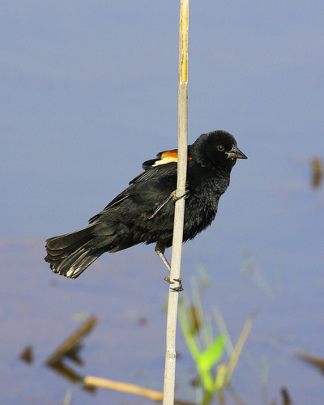

# Experimental Evaluation — 3 November 2026

**Evaluation status:** all 15 selected models have validation and test results: nine primary 10-shot runs and six supplementary 20-shot runs.

**Selection update — 3 November:** following Karina's clarification, standard-augmentation seed 0 uses her complete validation/test/runtime bundle (`archive/standard_aug_10shot_seed0_original`, checkpoint SHA-256 `3d4d3a61…`). Seeds 1–2 use Artem's T4 runs. The seed-0 reruns use the same experimental protocol but different weights, hardware/software and recorded source versions. The complete bundle is selected for consistent reporting, not because its test metric is higher. The T4 seed-0 run remains available as an alternative; no repeat inference or retraining is required.

## Evaluation protocol

We compare real-only training, standard augmentation and reviewed synthetic augmentation at 10 shots per species (2,000 real images). Standard augmentation adds 2,000 fixed crop/flip views; synthetic augmentation adds 1,440 reviewed images. Supplementary 20-shot runs compare 4,000 real images with 4,000 real + 1,440 synthetic images. There is no 20-shot standard-augmentation experiment. Each approach uses seeds 0–2 and the same real subset as its paired baseline.

All runs use ImageNet-pretrained ResNet-18 with frozen backbone/BatchNorm and a trainable 200-class head: AdamW, learning rate 0.001, weight decay 0.0001, batch size 64, 1,000 optimizer steps. Validation runs every 100 steps on the same 1,000 real images; maximum validation macro F1 selects the checkpoint. Evaluation uses RGB, resize of the shorter side to 256, a 224×224 center crop and ImageNet normalization. Test data did not select checkpoints.

## Final test metrics and comparison

Metrics are recomputed from hard-label predictions on all **5,794 official test images**, with all 200 species included in macro F1. Mean ± sample SD uses only the seeds shown; SD is not a confidence interval.

| Approach | Seeds | Macro F1 | Accuracy |
| --- | --- | ---: | ---: |
| Real-only, 10-shot | 0, 1, 2 | 54.82% ± 0.59 pp | 54.50% ± 0.49 pp |
| Standard augmentation, 10-shot | 0, 1, 2 | 55.25% ± 0.34 pp | 55.04% ± 0.25 pp |
| Reviewed synthetic, 10-shot | 0, 1, 2 | 52.25% ± 0.96 pp | 52.30% ± 0.86 pp |
| Real-only, 20-shot | 0, 1, 2 | 61.31% ± 0.19 pp | 61.30% ± 0.21 pp |
| Reviewed synthetic, 20-shot | 0, 1, 2 | 59.40% ± 0.66 pp | 59.50% ± 0.70 pp |

All paired comparisons subtract scores within the same seed and shot count, then summarize seeds 0–2.

| Paired test macro-F1 change | Seed 0 | Seed 1 | Seed 2 | Mean ± sample SD |
| --- | ---: | ---: | ---: | ---: |
| Standard − real-only, 10-shot | +0.50 pp | +0.10 pp | +0.68 pp | +0.43 ± 0.30 pp (n=3) |
| Synthetic − real-only, 10-shot | −3.82 pp | −2.42 pp | −1.49 pp | −2.57 ± 1.17 pp (n=3) |
| Synthetic − standard, 10-shot | -4.32 pp | -2.52 pp | -2.17 pp | -3.00 ± 1.16 pp (n=3) |
| Synthetic − real-only, 20-shot | −2.02 pp | −1.18 pp | −2.54 pp | −1.91 ± 0.69 pp (n=3) |

Reviewed synthetic augmentation underperforms the matching real-only baseline in every seed at both shot counts, consistent with validation. The average deficits are 2.57 and 1.91 pp at 10 and 20 shots. This answers the main question for this fixed synthetic pool and frozen-backbone setup; it does not establish that diffusion augmentation generally fails. Standard augmentation gives a small test macro-F1 gain in every paired seed: +0.43 ± 0.30 pp on average. With only three seeds, this is a descriptive result, not a claim of statistical significance.

Across species, mean F1 improves for 73/200 species at 10-shot and 72/200 at 20-shot; it declines for the remainder. These are descriptive changes, not significance tests. Increasing shots also lowers the synthetic-to-real ratio from 0.72:1 to 0.36:1, so this experiment cannot isolate which factor changes the synthetic deficit.

Earlier/diagnostic runs are reported separately to account for all supplied test exports. Each has only seed 0 and is excluded from the matched multi-seed comparison:

| Earlier or diagnostic run | Training entries | Macro F1 | Accuracy |
| --- | ---: | ---: | ---: |
| Real-only, full available training pool | 4,952 real | 62.24% | 62.12% |
| Unfiltered synthetic, 10-shot | 2,000 real + 2,000 synthetic | 50.64% | 50.66% |

All 17 exports contain the exact 5,794 expected test IDs and labels. Accuracy and macro F1 were independently recomputed from hard-label predictions. Original inference configurations were not supplied, so loss, confidence and inference time cannot be recovered; checkpoint metadata matches were checked, but local image inference was not rerun. [Per-run metrics and verification](../reports/evaluation_2026-11-03/README.md).

## Runtime and generation costs

Training times include 1,000 optimizer steps, periodic validation and checkpoint saves; they exclude setup and final evaluation.

| Approach | Seed 0, min | Seed 1, min | Seed 2, min | GPU |
| --- | ---: | ---: | ---: | --- |
| Real-only, 10-shot | 7.41 | 10.93 | 8.25 | RTX 4060 Laptop |
| Standard augmentation, 10-shot | 24.22 | 6.73 | 6.74 | RTX 4060 Laptop for seed 0; T4 for seeds 1–2 |
| Reviewed synthetic, 10-shot | 7.74 | 4.93 | 4.93 | RTX 4060 Laptop for seed 0; RTX 3070 for seeds 1–2 |
| Real-only, 20-shot | 10.39 | 9.34 | 6.95 | RTX 4060 Laptop |
| Reviewed synthetic, 20-shot | 7.07 | 6.95 | 6.70 | RTX 3070 |

Hardware and software differ between runs, so these times describe observed cost rather than a controlled speed comparison. Per-run versions and unrounded times are retained in [training_runtime.csv](../reports/evaluation_2026-11-03/training_runtime.csv).

Safina recorded **96.56 minutes** of pipeline calls to generate the 2,000-image main pool on an RTX 3070 (mean 2.90 seconds/image), plus **3.62 minutes** for the two 50-image pilots: **100.18 minutes total**. Main-pool cost per retained image is 4.02 seconds, including calls that produced rejected images. Generation is a one-off cost shared by all synthetic classifier runs; it is not charged again for every seed. These timings exclude model download/loading and manual review; no review-time estimate is available.

The review retained 1,120 `ok` and 320 `artifact` images and rejected 536 `wrong_species` and 24 `not_a_bird` images. The resulting 1,440-image pool covers 185 species; 15 receive no synthetic images. Source: [generation records](../reports/generation/generation_records.md).

## Failure analysis

The three cases below represent persistent regressions after adding synthetic data: every 10-shot baseline seed predicts the true class, while every synthetic seed is wrong. Selection is deterministic (first qualifying image from each of three distinct species in test-manifest order), not a random sample of all errors. The examples illustrate this failure pattern; they do not estimate its frequency.

The photos are original, unmodified images from [the project's CUB dataset](https://huggingface.co/datasets/birder-project/CUB_200_2011); the model uses the resize/center-crop preprocessing described above. IDs beginning `validation/` belong to the official test split in this dataset mirror. [Image sources and hashes](../reports/evaluation_2026-11-03/failure_images/sources.json) and [exact predictions](../reports/evaluation_2026-11-03/test_failure_examples.csv) are retained.

### 1. Laysan Albatross → Northern Fulmar

**Synthetic predictions, seeds 0/1/2:** Northern Fulmar / Northern Fulmar / Northern Fulmar.

**Observation:** a white head and body contrast with dark wings against textured water; the bill occupies a small part of the frame. **Possible reason:** the classifier may emphasize broad colour/background features over finer bill and wing-shape cues after resizing and cropping. The repeated wrong label suggests a consistent confusion, but does not prove which features the model used.

### 2. Sooty Albatross → Black Tern / Pomarine Jaeger

**Synthetic predictions, seeds 0/1/2:** Black Tern / Pomarine Jaeger / Pomarine Jaeger.

**Observation:** the underside of the flying bird is largely dark, with small eye and bill details. **Possible reason:** a dark flight silhouette may dominate the fixed visual features, leaving insufficient weight on fine species cues. Different wrong labels across seeds suggest that the competing class boundaries also depend on the training subset/initialization.

### 3. Red-winged Blackbird → American Crow

**Synthetic predictions, seeds 0/1/2:** American Crow / American Crow / American Crow.

**Observation:** the bird is mostly black, a reed crosses its body, and the red/yellow shoulder marking is small and partly obscured. **Possible reason:** broad dark-plumage features may outweigh the small distinguishing patch. This is a plausible explanation for the confusion, not evidence from saliency or a controlled occlusion test.

The baseline succeeds on all three images under the same evaluation preprocessing, so cropping or visual difficulty alone cannot explain the regression. Synthetic domain differences, uneven class coverage, retained visual defects and reduced real-image exposure within the fixed step budget could change the learned head's decision boundaries. The current experiments do not isolate these causes.

## Completion status

All planned approaches now have three selected test results. Validation, test and runtime for standard seed 0 all refer to Karina’s checkpoint; no result is borrowed from the T4 seed-0 rerun. The three illustrated failure examples and runtime comparison are complete. Original inference-environment records remain unavailable; this provenance limitation does not prevent recomputing the supplied predictions.

Detailed validation tables, reproducibility evidence, team handoff notes and literature/presentation material are preserved in [supporting notes for 10 November](FINAL_PRESENTATION_NOTES_2026-11-10.md).
