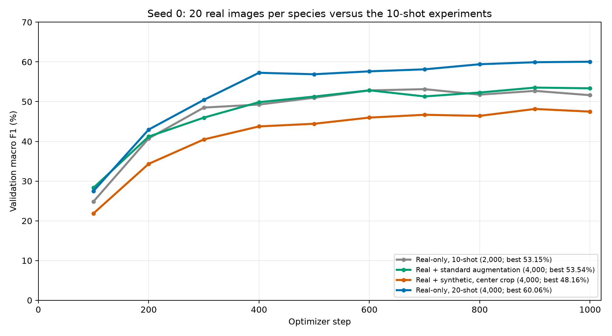

# Real-only 20-shot experiment, seed 0

Run date: 16 October 2026.

The 20-shot real-only classifier achieved **60.06% validation macro F1** and **59.80% accuracy**, with the best checkpoint at step 1000.
Macro F1 differs from the 10-shot real-only baseline by **+6.91 percentage points**.

| Training arm | Real originals | Standard variants | Generated | Total | Macro F1 | Accuracy | Best step |
| --- | ---: | ---: | ---: | ---: | ---: | ---: | ---: |
| Real-only, 10-shot | 2,000 | 0 | 0 | 2,000 | 53.15% | 53.30% | 700 |
| Real + standard augmentation | 2,000 | 2,000 | 0 | 4,000 | 53.54% | 53.70% | 900 |
| Real + synthetic, center crop | 2,000 | 0 | 2,000 | 4,000 | 48.16% | 48.90% | 900 |
| Real-only, 20-shot | 4,000 | 0 | 0 | 4,000 | 60.06% | 59.80% | 1000 |

Compared with the equally sized real + standard and real + synthetic pools, the 20-shot arm differs by +6.52 and +11.90 points, respectively.
The 20-shot pool contains 4,000 distinct real images. Each added-data pool contains 2,000 distinct real images plus 2,000 additional views or generated images. All 2,000 real images in the 10-shot subset are included in the 20-shot subset.



[Aggregate results CSV](20shot_seed0.csv). The existing three-run augmentation report is unchanged.

All 4,000 real training images use RGB conversion, aspect-ratio-preserving resizing of the shorter side to 256, a 224 x 224 center crop, tensor conversion and ImageNet normalization. No random crops, flips or generated images are added. Validation uses the same preprocessing.

Settings match the 10-shot real-only baseline: seed 0, ImageNet ResNet-18 with frozen backbone and BatchNorm, newly initialized 200-class head, 1,000 AdamW steps, batch size 64, learning rate 0.001, weight decay 0.0001, CUDA with AMP, and validation every 100 steps. All runs select their checkpoint by macro F1 on the same 1,000 real validation images. The fixed step budget is preserved rather than matching the number of passes through the different-sized datasets.

These are exploratory results from one seed and validation-selected checkpoints. No classifier test metrics were computed.

Command:

```bash
python src/train_classifier.py --k-shot 20 --seed 0 --device cuda --amp
```

Output directory: `outputs/baseline_20shot_seed0/`.

- `best.pt`: best checkpoint.
- `config.json`: settings, preprocessing, class mapping, environment and source/input hashes.
- `history.csv`: periodic training loss and validation metrics.
- `runtime.json`: best step and training/validation runtime.
- `val_metrics.json`, `val_per_class.json`, `val_predictions.csv`: aggregate, per-species and per-image validation results.

Dataset manifest: `splits/manifests/train_20shot_seed0.csv` (4,000 unique images, 20 per species).

Training with periodic validation and checkpoint saves took 7.70 minutes; this excludes setup and final evaluation.

Verification checked 20 images per class, nesting of the 10-shot subset, no validation/test image overlap, identical validation IDs and fixed settings across the four compared runs, best-step agreement between history and saved metrics, per-class macro F1 agreement, and all new-run source/input hashes. No training-code changes were needed.
