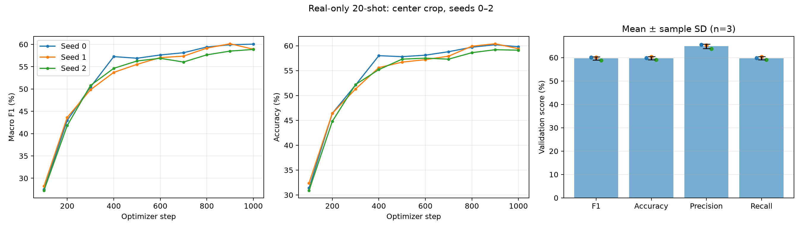

# Real-only 20-shot experiment, seeds 0–2

Run date: 23 October 2026. Three fresh runs; earlier seed-0 results are preserved.

| Seed | Macro F1 | Accuracy | Macro precision | Macro recall | Val loss | Best step | Time (min) |
| --- | ---: | ---: | ---: | ---: | ---: | ---: | ---: |
| 0 | 60.06% | 59.80% | 65.54% | 59.80% | 1.5530 | 1000 | 10.39 |
| 1 | 60.15% | 60.40% | 65.25% | 60.40% | 1.5603 | 900 | 9.34 |
| 2 | 58.87% | 59.10% | 63.82% | 59.10% | 1.5445 | 1000 | 6.95 |
| **Mean ± SD** | 59.69% ± 0.71 pp | 59.77% ± 0.65 pp | 64.87% ± 0.92 pp | 59.77% ± 0.65 pp | 1.5526 ± 0.0079 | — | 8.89 ± 1.76 |

SD is the sample standard deviation across three seeds (`ddof=1`). Score SDs are in percentage points (pp). Seeds change both the existing 20-shot subset and head initialization / shuffled training order. Macro precision, recall and F1 give equal weight to each of 200 species. Validation has five images per species, so macro recall equals accuracy.



Each run uses 4,000 distinct real images (20 per species). RGB conversion, aspect-ratio-preserving resize of the shorter side to 256, 224×224 center crop, tensor conversion and ImageNet normalization apply to training and validation. No generated images or additional augmented views are used.

Settings match the earlier 20-shot run: ImageNet ResNet-18 with frozen backbone and BatchNorm, new 200-class linear head, AdamW, learning rate 0.001, weight decay 0.0001, batch size 64, 1,000 optimizer steps, validation every 100 steps, CUDA with AMP, zero data-loader workers. Each checkpoint is selected independently by maximum macro F1 on the same 1,000-image validation split. Reported validation metrics use that selected checkpoint; test metrics were not computed. Three-seed variability is descriptive and is not a confidence interval or a test-set estimate.

```bash
python src/train_classifier.py --k-shot 20 --seed 0 --device cuda --amp --output outputs/20shot_seeds0-2_20261023/baseline_20shot_seed0
python src/train_classifier.py --k-shot 20 --seed 1 --device cuda --amp --output outputs/20shot_seeds0-2_20261023/baseline_20shot_seed1
python src/train_classifier.py --k-shot 20 --seed 2 --device cuda --amp --output outputs/20shot_seeds0-2_20261023/baseline_20shot_seed2
```

Outputs: `outputs/20shot_seeds0-2_20261023/baseline_20shot_seed{0,1,2}/`, each containing `best.pt`, `config.json`, `history.csv`, `runtime.json`, `val_metrics.json`, `val_per_class.json`, `val_predictions.csv`, and `train.log`. Runtime includes training, periodic validation and checkpoint saving; excludes setup and final evaluation. The batch's `source_snapshot/` and `provenance.json` preserve source/input files and their hashes.

Files: [per-run CSV](20shot_seeds0-2.csv), [mean and SD CSV](20shot_seeds0-2_summary.csv), [JSON](20shot_seeds0-2.json), [per-class scores](20shot_seeds0-2_per_class.csv).

Verification passed: unique training IDs, 20 images per species, containment in the training pool, no validation/test overlap, shared class mapping and fixed settings, all recorded hashes against current files and the preserved snapshot, validation IDs in manifest order, aggregate and per-class metrics recomputed from predictions, and best checkpoint step / metrics matched to history.
