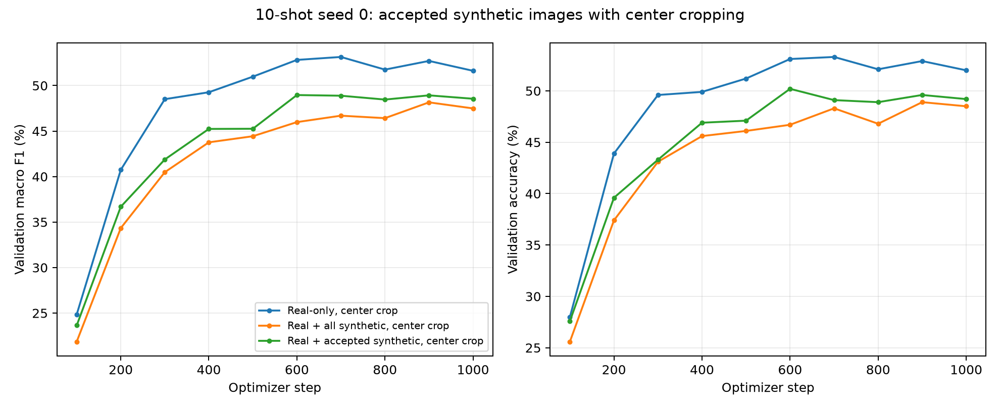

# Accepted synthetic augmentation, 10-shot seed 0

Run date: 23 October 2026.

| Training arm | Real | Synthetic | Total | Macro F1 | Accuracy | Best step |
| --- | ---: | ---: | ---: | ---: | ---: | ---: |
| Real-only, center crop | 2,000 | 0 | 2,000 | 53.15% | 53.30% | 700 |
| Real + all synthetic, center crop | 2,000 | 2,000 | 4,000 | 48.16% | 48.90% | 900 |
| Real + accepted synthetic, center crop | 2,000 | 1,440 | 3,440 | 48.96% | 50.20% | 600 |

The accepted-only run differs from real-only by **-4.19 percentage points** in validation macro F1, and from the unreviewed synthetic run by **+0.80 points**. Macro precision is 54.63%, macro recall is 50.20%, and validation cross-entropy loss is 1.9849.



The real subset is `splits/manifests/train_10shot_seed0.csv`: 2,000 images, 10 per species. Synthetic preparation keeps the review decisions `ok` (1,120 images) and `artifact` (320), excluding `wrong_species` (536) and `not_a_bird` (24). All 1,440 accepted images remain after checking MD5 equality and ResNet-18 feature cosine similarity at 0.93 against real validation and test images; zero matches were found. These checks use held-out images only for duplicate detection, with no classifier test metrics computed.

Accepted synthetic images cover 185 species. Of 200 species, 118 have fewer than 10 synthetic images, including 15 with none. All available accepted images are retained; missing synthetic counts are not filled using rejected images. The mixed training pool has 3,440 entries. The old 2,000-image synthetic manifest is preserved; the reviewed manifest is `data/synthetic/sd15_wildlife/prepared_accepted/manifest.csv`.

Both real and synthetic images use RGB conversion, aspect-ratio-preserving resize of the shorter side to 256, 224×224 center crop, tensor conversion and ImageNet normalization. Validation uses the same transform. No extra crop/flip variants are appended (`--augment` is omitted).

Settings match the previous seed-0 controls: ImageNet ResNet-18, frozen backbone and BatchNorm, newly initialized 200-class linear head, AdamW learning rate 0.001, weight decay 0.0001, batch size 64, 1,000 optimizer steps, validation every 100 steps, CUDA with AMP and zero loader workers. The best checkpoint is selected by macro F1 on all 1,000 real validation images. Training with periodic validation and checkpoint saves took 7.74 minutes, excluding setup and final evaluation.

This is a single-seed validation comparison; no across-seed standard deviation is estimated. Filtering changes both synthetic quality and pool size/class coverage, so this comparison does not isolate quality alone.

```bash
python src/prepare_synthetic.py --device cuda --review reports/generation/review_sd15_wildlife.csv --per-class 10 --output data/synthetic/sd15_wildlife/prepared_accepted
python src/train_classifier.py --k-shot 10 --seed 0 --device cuda --amp --synthetic-manifest data/synthetic/sd15_wildlife/prepared_accepted/manifest.csv --output outputs/accepted_synthetic_10shot_seed0_20261023/real_synthetic_10shot_seed0
```

Run files in `outputs/accepted_synthetic_10shot_seed0_20261023/real_synthetic_10shot_seed0/`: `best.pt`, `config.json`, `history.csv`, `runtime.json`, `val_metrics.json`, `val_per_class.json`, `val_predictions.csv`, and `train.log`. The parent batch folder preserves preparation logs, source/input snapshots and provenance hashes.

[Comparison CSV](accepted_synthetic_10shot_seed0.csv) · [JSON](accepted_synthetic_10shot_seed0.json) · [Per-class scores](accepted_synthetic_10shot_seed0_per_class.csv)

Verification passed: accepted-review membership and exact counts, image content hashes, no held-out ID overlap, real subset size and per-class counts, matching preprocessing and fixed training settings across compared runs, source/input hashes against current files and snapshots, checkpoint/config/runtime agreement, validation IDs in manifest order, and aggregate/per-class metrics recomputed from predictions.
