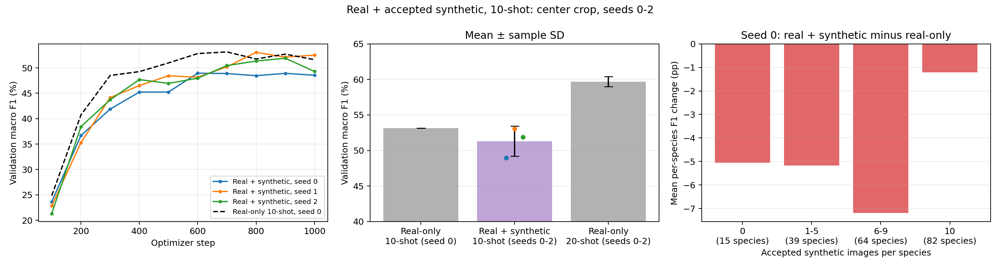

# Real + accepted synthetic augmentation, 10-shot, seeds 0–2

Run dates: seed 0 on 23 October 2026 (RTX 4060 Laptop), seeds 1–2 on 24 October 2026 (RTX 3070).

| Seed | Macro F1 | Accuracy | Macro precision | Macro recall | Val loss | Best step | Time (min) | GPU |
| --- | ---: | ---: | ---: | ---: | ---: | ---: | ---: | --- |
| 0 | 48.96% | 50.20% | 54.63% | 50.20% | 1.9849 | 600 | 7.74 | RTX 4060 Laptop GPU |
| 1 | 53.06% | 53.90% | 58.06% | 53.90% | 1.8665 | 800 | 4.93 | RTX 3070 |
| 2 | 51.90% | 52.20% | 57.56% | 52.20% | 1.8218 | 900 | 4.93 | RTX 3070 |
| **Mean ± SD** | 51.31% ± 2.11 pp | 52.10% ± 1.85 pp | 56.75% ± 1.85 pp | 52.10% ± 1.85 pp | 1.8911 ± 0.0843 | — | 5.87 ± 1.62 | |

SD is the sample standard deviation across three seeds (`ddof=1`); score SDs are in percentage points (pp). A seed changes the 10-shot real subset, head initialization and shuffled training order; the synthetic pool is the same in all three runs.

## Comparison with real-only training

| Training data | Real | Synthetic | Seeds | Validation macro F1 | Accuracy |
| --- | ---: | ---: | --- | ---: | ---: |
| Real-only, 10-shot | 2,000 | 0 | 0 | 53.15% | 53.30% |
| **Real + accepted synthetic, 10-shot** | 2,000 | 1,440 | 0-2 | **51.31% ± 2.11 pp** | **52.10% ± 1.85 pp** |
| Real-only, 20-shot | 4,000 | 0 | 0-2 | 59.69% ± 0.71 pp | 59.77% ± 0.65 pp |



## Conclusions

1. **Synthetic images did not improve validation macro F1.** In the only paired comparison (seed 0, same 2,000 real images), adding 1,440 accepted synthetic images changed macro F1 by **-4.19 pp** (53.15% → 48.96%). Across seeds 0–2 the synthetic arm reaches 51.31% ± 2.11 pp. Seed 1 scores 53.06%, close to the seed-0 real-only run, but it uses a different real subset; its paired change is unknown until real-only 10-shot seeds 1–2 exist.
2. **Real images are worth much more than synthetic ones.** The same 2,000 real images plus 2,000 more real ones (20-shot) give 59.69% ± 0.71 pp, **8.4 pp above** the synthetic arm with a similar training-set size (4,000 vs. 3,440 entries).
3. **No species group gained on average, and species with incomplete synthetic sets lost most.** In seed 0, species with all 10 synthetic images changed by -1.21 pp (32 better, 33 worse of 82); species with 0–9 synthetic images changed by -7.19 to -5.05 pp. Their real-only F1 is similar (50–57%), so they were not simply harder. One explanation consistent with this: filtering left 10 to 20 training entries per species, and a classifier trained on this uneven mix favors species with more entries. With 5 validation images per species, one prediction moves a species' F1 by up to ~20 pp, so the pattern is single-seed and noisy.
4. **Generation and preparation are reproducible.** Seeds 1–2 were prepared and trained on another machine; the prepared manifest is byte-identical to the seed-0 one (same SHA-256), and all runs share code, split manifests and training settings.

Likely reasons, not tested here: the uneven per-species synthetic counts described above; manual review removed wrong-species images but cannot verify subtle field marks, so some accepted images still carry misleading features; at a fixed 1,000-step budget, synthetic images take 42% of presentations away from real ones; SD images differ from CUB photos in style (centered, clean backgrounds), which a frozen ImageNet backbone may encode differently.

## Setup

Each run uses its seed's `splits/manifests/train_10shot_seed{s}.csv` (2,000 real images, 10 per species) plus `data/synthetic/sd15_wildlife/prepared_accepted/manifest.csv`: 1,440 accepted images (`ok` 1,120, `artifact` 320) from the 2,000-image `sd15_wildlife` pool, with zero matches against validation/test. 185 species have synthetic images; 118 have fewer than 10, including 15 with none (synthetic-to-real ratio 0.72:1 overall). Rejected images are not used to fill the gaps.

Both real and synthetic images use RGB conversion, aspect-ratio-preserving resize of the shorter side to 256, 224×224 center crop, tensor conversion and ImageNet normalization; no crop/flip variants (`--augment` omitted). Settings match all real-only runs: ImageNet ResNet-18 with frozen backbone and BatchNorm, new 200-class linear head, AdamW, learning rate 0.001, weight decay 0.0001, batch size 64, 1,000 optimizer steps, validation every 100 steps, CUDA with AMP, zero loader workers. Each checkpoint is selected by macro F1 on the same 1,000 real validation images; test metrics were not computed. Runtime covers training, periodic validation and checkpoint saves and depends on the GPU.

```bash
python src/prepare_synthetic.py --device cuda --review reports/generation/review_sd15_wildlife.csv --per-class 10 --output data/synthetic/sd15_wildlife/prepared_accepted
python src/train_classifier.py --k-shot 10 --seed 0 --device cuda --amp --synthetic-manifest data/synthetic/sd15_wildlife/prepared_accepted/manifest.csv --output outputs/accepted_synthetic_10shot_seed0_20261023/real_synthetic_10shot_seed0
python src/train_classifier.py --k-shot 10 --seed 1 --device cuda --amp --synthetic-manifest data/synthetic/sd15_wildlife/prepared_accepted/manifest.csv --output outputs/accepted_synthetic_10shot_seed1
python src/train_classifier.py --k-shot 10 --seed 2 --device cuda --amp --synthetic-manifest data/synthetic/sd15_wildlife/prepared_accepted/manifest.csv --output outputs/accepted_synthetic_10shot_seed2
python src/report_synthetic_seeds.py --runs outputs/accepted_synthetic_10shot_seed0_20261023/real_synthetic_10shot_seed0 outputs/accepted_synthetic_10shot_seed1 outputs/accepted_synthetic_10shot_seed2 --prepared reports/generation/prepared_sd15_wildlife_accepted --output-prefix reports/accepted_synthetic_10shot_seeds0-2
```

The prepared manifest and leakage report are in [generation/prepared_sd15_wildlife_accepted/](generation/prepared_sd15_wildlife_accepted/). Checkpoints (`best.pt`) are on the shared Drive.

Files: [per-run CSV](accepted_synthetic_10shot_seeds0-2.csv), [mean and SD CSV](accepted_synthetic_10shot_seeds0-2_summary.csv), [JSON](accepted_synthetic_10shot_seeds0-2.json), [per-class scores](accepted_synthetic_10shot_seeds0-2_per_class.csv), [change by synthetic count](accepted_synthetic_10shot_seeds0-2_by_synthetic_count.csv).

## Change by synthetic count, seed 0

| Synthetic images per species | Species | Real-only F1 | Real + synthetic F1 | Change | Better / same / worse |
| --- | ---: | ---: | ---: | ---: | --- |
| 0 | 15 | 49.60% | 44.55% | -5.05 pp | 6 / 2 / 7 |
| 1-5 | 39 | 56.62% | 51.45% | -5.17 pp | 12 / 6 / 21 |
| 6-9 | 64 | 51.69% | 44.49% | -7.19 pp | 20 / 10 / 34 |
| 10 | 82 | 53.28% | 52.07% | -1.21 pp | 32 / 17 / 33 |

## Limitations

Single real-only 10-shot seed: the paired change and its variability are known for seed 0 only. Validation is also used for checkpoint selection, so all numbers are optimistic. Three seeds give a descriptive SD, not a confidence interval. Filtering changed both image quality and class coverage, so this run alone does not separate the effect of quality from the effect of the smaller, uneven pool.

Verification passed: fixed settings in every config, identical synthetic manifest and class mapping across seeds, recorded hashes against current split manifests, code and the prepared files, no synthetic/held-out overlap, baseline sharing settings and the seed-0 real subset, validation IDs in manifest order, aggregate and per-class metrics recomputed from predictions, and best checkpoint step / metrics matched to history.
