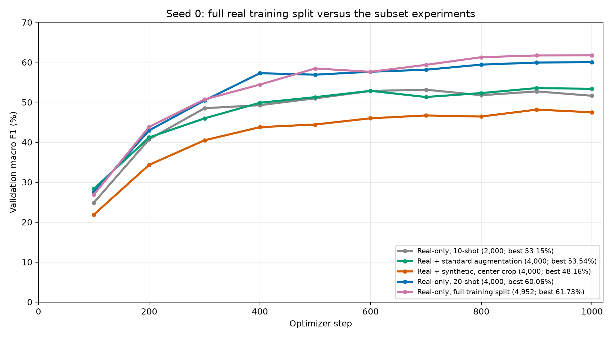

# Full real training split, seed 0

Run date: 16 October 2026.

Training on all 4,952 real training images achieved **61.73% validation macro F1** and **62.30% accuracy**. The selected checkpoint is step 1000.
Macro F1 differs from the 4,000-image 20-shot real-only run by **+1.68 percentage points**, and from the 2,000-image 10-shot baseline by **+8.59 points**.

| Training arm | Real originals | Standard variants | Generated | Total | Macro F1 | Accuracy | Best step |
| --- | ---: | ---: | ---: | ---: | ---: | ---: | ---: |
| Real-only, 10-shot | 2,000 | 0 | 0 | 2,000 | 53.15% | 53.30% | 700 |
| Real + standard augmentation | 2,000 | 2,000 | 0 | 4,000 | 53.54% | 53.70% | 900 |
| Real + synthetic, center crop | 2,000 | 0 | 2,000 | 4,000 | 48.16% | 48.90% | 900 |
| Real-only, 20-shot | 4,000 | 0 | 0 | 4,000 | 60.06% | 59.80% | 1000 |
| Real-only, full training split | 4,952 | 0 | 0 | 4,952 | 61.73% | 62.30% | 1000 |



[Aggregate results CSV](all_train_seed0.csv). Existing augmentation and 20-shot reports are preserved.

The full pool is exactly `splits/manifests/train.csv`: 4,952 unique real images, 20-25 per species across 200 species. It includes all 4,000 images in `train_20shot_seed0.csv`. The extra 952 real images expand the training pool; validation and test images are excluded.

All training images use RGB conversion, aspect-ratio-preserving resizing of the shorter side to 256, a 224 x 224 center crop, tensor conversion and ImageNet normalization. No random crops, flips or generated images are added. Validation uses the same preprocessing.

Settings match the earlier runs: seed 0, ImageNet ResNet-18 with frozen backbone and BatchNorm, newly initialized 200-class linear head, 1,000 AdamW steps, batch size 64, learning rate 0.001, weight decay 0.0001, CUDA with AMP, and validation every 100 steps. All select checkpoints by macro F1 on the same 1,000 real validation images.

The step budget is fixed, so this is about 13 passes through the full pool versus about 16 through the 20-shot pool. This is an exploratory comparison at the existing training budget; it does not establish convergence or a general advantage from one seed. Classifier test metrics were not computed.

Command:

```bash
python src/train_classifier.py --all-train --seed 0 --device cuda --amp
```

`--all-train` is mutually exclusive with `--k-shot`. The existing default remains 10-shot. This run records `k_shot: null` and the full training-manifest hash.

Output directory: `outputs/baseline_all_train_seed0/`.

- `best.pt`: selected checkpoint.
- `config.json`: settings, preprocessing, class mapping, environment and source/input hashes.
- `history.csv`: periodic training loss and validation metrics.
- `runtime.json`: best step and training/validation runtime.
- `val_metrics.json`, `val_per_class.json`, `val_predictions.csv`: aggregate, per-species and per-image validation results.
- `source_snapshot/` and `provenance.json`: preserved source/input files and their revision/hash provenance.

Training with periodic validation and checkpoint saves took 11.12 minutes; this excludes setup and final evaluation.

The workspace advanced to commit `c110b0f` while training was in progress. The process used the source already loaded at startup. Recorded source hashes were recovered byte-for-byte from revision `27c903863e1bf87069b909c2e8c6cda621b6c6db`, with the original line endings preserved. Every source/input file hashed in the original run config has a matching copy under `source_snapshot/`. The snapshot also includes `load_data.py` from that revision, which the older training code did not hash. The original config and checkpoint have not been rewritten.

Verification: all 14 unit tests passed before training on the matching source version, including default/subset/full-training selection and mutually exclusive CLI arguments. Artifact checks confirmed the full manifest exactly matches the saved training split, uniqueness, per-class counts, inclusion of the 20-shot subset, no held-out image overlap, identical validation IDs and fixed settings across compared runs, best-step agreement between history and saved metrics, per-class macro F1 agreement, and all recorded hashes against the preserved snapshot.
