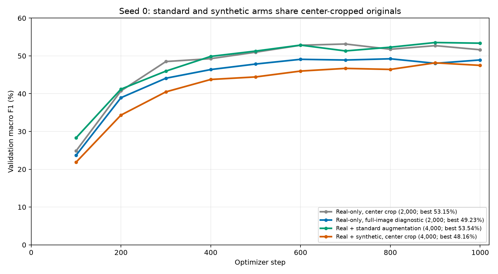

# Standard augmentation and synthetic data with shared center cropping, seed 0

Run date: 16 October 2026. The original center-crop baseline is from 12 October.

Validation results from the best checkpoints:

| Arm | Training entries | Macro F1 | Accuracy | Best step | Training + validation (min) |
| --- | ---: | ---: | ---: | ---: | ---: |
| Real-only, center crop | 2,000 | 53.15% | 53.30% | 700 | 7.41 |
| Real-only, full-image diagnostic | 2,000 | 49.23% | 50.00% | 800 | 16.10 |
| Real + standard augmentation | 4,000 | 53.54% | 53.70% | 900 | 24.22 |
| Real + synthetic, center crop | 4,000 | 48.16% | 48.90% | 900 | 8.86 |

The standard arm differs from the matched center-crop real-only baseline by +0.39 percentage points of macro F1; the synthetic arm differs by -4.99 points.
With both 4,000-entry arms sharing original-image preprocessing, synthetic versus standard is -5.38 points in this seed.

Switching both real and generated views to resize/center-crop changed synthetic macro F1 from 45.08% to 48.16% (+3.08 points) versus the archived full-image run. This changes both sources together and does not isolate which source caused the difference.
The historical real-only full-image diagnostic is -3.91 points relative to the center-crop baseline; it is not the matched reference for the current added-data arms.

These are validation results from one seed, with checkpoint selection on the same validation set. They do not establish a general advantage or a cause for the remaining difference. Runtime covers training, periodic validation and checkpoint saves; it excludes setup, final evaluation, generation and preparation.



[Aggregate results](augmentation_seed0.csv) and [per-class comparisons](augmentation_seed0_per_class.csv).

Verification: all 13 unit tests passed. Mixed-source tests check that real tensors match baseline center-cropped tensors and generated tensors match the same resize/center-crop transform, with seed-independent outputs and preserved left/right orientation. Final artifacts agree on all 1,000 validation IDs, fixed training settings, shared split/model hashes and best-checkpoint metrics. The new synthetic run records hashes matching the current source files, prepared manifest and leakage report. Test classifier metrics were not computed.

| Pipeline | Real originals | Augmented real versions | Synthetic images | Total |
| --- | ---: | ---: | ---: | ---: |
| Real-only, center crop | 2,000 | 0 | 0 | 2,000 |
| Real-only, full-image diagnostic | 2,000 | 0 | 0 | 2,000 |
| Real + standard augmentation | 2,000 | 2,000 | 0 | 4,000 |
| Real + synthetic | 2,000 | 0 | 2,000 | 4,000 |

All arms use the same `train_10shot_seed0.csv` real subset, 10 originals per species. Both
4,000-entry arms contain 20 entries per species. The center-crop baseline, both arms' original
2,000 views and the generated images now share deterministic preprocessing: RGB conversion,
aspect-ratio-preserving resize of the shorter side to 256, center crop to 224 x 224, tensor
conversion and ImageNet normalization. The real + synthetic arm has no random crops or flips.
Generated JPGs on disk are unchanged; this preprocessing is applied when loading them for training.

The standard arm retains one additional fixed augmented version per real original: random resized
crop to 224 x 224, area 50-100%, followed by horizontal flip with probability 0.5. Image ID and
run seed fix that version across accesses and workers. These versions are made from source
photos, independently of the deterministic center-cropped original views, and recreated lazily.

Both 4,000-entry loaders shuffle originals and additional entries uniformly with the same seed,
so original source IDs, original pixel values and original/additional entry positions are paired.
Approximately half the presentations are original views and half are additional views. At a fixed
step budget, the synthetic arm has fewer real-image presentations than the real-only baseline.
Both added-data arms should now be compared against the original center-crop real-only baseline.

The full-image real-only control is a historical preprocessing diagnostic. It resizes whole
images directly to 224 x 224, which can change aspect ratios. It is not the matched reference
for either current added-data arm. Validation/test always use resize-to-256 and center-crop.

All runs use ImageNet ResNet-18 with frozen backbone/BatchNorm and a newly initialized 200-class
head. Settings: seed 0, 1,000 AdamW steps, batch size 64, learning rate 0.001, weight decay 0.0001,
validation every 100 steps, CUDA and AMP. Checkpoints are selected by validation macro F1 on the
same 1,000 real validation images. Classifier test metrics are not computed. These are single-seed
observations; remaining differences do not by themselves establish synthetic species fidelity.

The synthetic pool is `data/synthetic/sd15_wildlife/prepared/manifest.csv`: 2,000 images, 10 per
species. Preparation verified label mappings, decoding and original metadata MD5 hashes, excluded
contact sheets, and detected no duplicates against validation/test using MD5 equality or ResNet-18
feature cosine similarity at 0.93, ignoring labels. Manual species-fidelity review is separate.

```bash
python src/train_classifier.py --seed 0 --device cuda --amp
python src/train_classifier.py --seed 0 --full-image --device cuda --amp
python src/train_classifier.py --seed 0 --augment --device cuda --amp
python src/train_classifier.py --seed 0 --device cuda --amp --synthetic-manifest data/synthetic/sd15_wildlife/prepared/manifest.csv
```

Existing outputs are preserved; pass a new `--output` directory to rerun these commands. Active
directories are `outputs/baseline_10shot_seed0`, `outputs/baseline_full_image_10shot_seed0`,
`outputs/standard_aug_10shot_seed0` and `outputs/real_synthetic_10shot_seed0`.

The old real + synthetic full-image run and its report are archived at
`outputs/archive/real_synthetic_10shot_seed0_full_image_4000`. Earlier standard variants are under
`outputs/archive/standard_aug_10shot_seed0_full_image_originals_4000` and
`outputs/archive/standard_aug_10shot_seed0_online_2000`. Archived variants are excluded from the
current curves and aggregate CSV.
