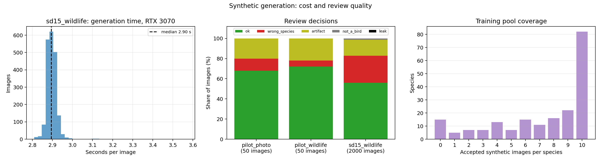

# Synthetic generation: cost and quality records

Model `stable-diffusion-v1-5/stable-diffusion-v1-5`, text-to-image from species-name prompts, float16, DPMSolverMultistepScheduler with 25 steps, guidance 7.5, 512×512, batch size 1. Each pool was generated on a single GPU.

| Pool | Images | GPU | Median s/image | Mean s/image | Total (min) | s per accepted image |
| --- | ---: | --- | ---: | ---: | ---: | ---: |
| `pilot_photo` | 50 | RTX 3070 | 2.16 | 2.17 | 1.8 | 2.46 |
| `pilot_wildlife` | 50 | RTX 3070 | 2.17 | 2.18 | 1.8 | 2.32 |
| `sd15_wildlife` | 2,000 | RTX 3070 | 2.90 | 2.90 | 96.6 | 4.02 |

Time is one pipeline call per image as recorded in `gen_time_s`; it excludes model download and loading. The first image of each run includes CUDA warm-up, so the median is the representative per-image cost. "s per accepted image" divides the total time by the images that passed review. Generation is a one-off cost: the same pool is reused by every classifier seed, and classifier training time is reported separately.

## Review quality

| Pool | `ok` | `wrong_species` | `artifact` | `not_a_bird` | `leak` | Accepted | Val/test matches |
| --- | ---: | ---: | ---: | ---: | ---: | ---: | ---: |
| `pilot_photo` | 34 | 6 | 10 | 0 | 0 | 44 (88.0%) | 0 |
| `pilot_wildlife` | 36 | 3 | 11 | 0 | 0 | 47 (94.0%) | 0 |
| `sd15_wildlife` | 1,120 | 536 | 320 | 24 | 0 | 1,440 (72.0%) | 0 |

Accepted means `ok` or `artifact`: the labeled species with or without visual defects. `wrong_species`, `not_a_bird` and `leak` are dropped. No synthetic image matched a validation or test photo (MD5 or ResNet-18 embedding similarity).

### Pilot: template and species fidelity

| Template | Species group | Images | Right species (`ok` + `artifact`) | `ok` |
| --- | --- | ---: | ---: | ---: |
| photo | distinctive | 25 | 21 | 19 |
| photo | hard | 25 | 23 | 15 |
| wildlife | distinctive | 25 | 23 | 19 |
| wildlife | hard | 25 | 24 | 17 |

25 images per group: 5 species × 5 images, with the same seeds for both templates. `wildlife` produced fewer wrong-species images (3 vs. 6); the full pool uses `wildlife`. Hard species (gulls, a sparrow, a flycatcher, a warbler) were the right species at least as often as distinctive ones in this small sample.

## Training pool

`reports/generation/prepared_sd15_wildlife_accepted` holds 1,440 images: all accepted images, at most 10 per species, after a second leakage check against validation and test. 185 of 200 species have at least one synthetic image; the overall synthetic-to-real ratio with 2,000 real images is 0.72:1.

| Accepted images per species | Species | Images |
| --- | ---: | ---: |
| 0 | 15 | 0 |
| 1-5 | 39 | 127 |
| 6-9 | 64 | 493 |
| 10 | 82 | 820 |

Species without synthetic images in training (only real images):

| Species | `ok` | `artifact` | `wrong_species` | `not_a_bird` | Accepted |
| --- | ---: | ---: | ---: | ---: | ---: |
| Crested Auklet | 0 | 0 | 10 | 0 | 0 |
| Parakeet Auklet | 0 | 0 | 10 | 0 | 0 |
| Pelagic Cormorant | 0 | 0 | 10 | 0 | 0 |
| Gray-crowned Rosy Finch | 0 | 0 | 10 | 0 | 0 |
| White-breasted Kingfisher | 0 | 0 | 10 | 0 | 0 |
| White-necked Raven | 0 | 0 | 10 | 0 | 0 |
| Field Sparrow | 0 | 0 | 10 | 0 | 0 |
| Bank Swallow | 0 | 0 | 10 | 0 | 0 |
| Bay-breasted Warbler | 0 | 0 | 10 | 0 | 0 |
| Chestnut-sided Warbler | 0 | 0 | 10 | 0 | 0 |
| Golden-winged Warbler | 0 | 0 | 10 | 0 | 0 |
| Kentucky Warbler | 0 | 0 | 10 | 0 | 0 |
| Palm Warbler | 0 | 0 | 10 | 0 | 0 |
| American Three-toed Woodpecker | 0 | 0 | 10 | 0 | 0 |
| Red-cockaded Woodpecker | 0 | 0 | 10 | 0 | 0 |



## Reproduce

```bash
python src/generate.py --pilot
python src/generate.py --pilot --template wildlife
python src/generate.py --template wildlife --per-class 10
python src/review_synthetic.py --pool sd15_wildlife
python src/prepare_synthetic.py --device cuda --review reports/generation/review_sd15_wildlife.csv --per-class 10 --output data/synthetic/sd15_wildlife/prepared_accepted
python src/report_generation.py --prepared reports/generation/prepared_sd15_wildlife_accepted --output-prefix reports/generation/generation_records
```

Files: [cost and decisions per pool](generation_records_by_pool.csv), [decisions per species](generation_records_per_class.csv), [JSON](generation_records.json). Review tables and leakage reports: `reports/generation/review_{pool}.csv`, `reports/generation/leakage_{pool}.json`.

## Limitations

Timings come from a single GPU and include no review time, review decisions are manual. The pilot has 25 images per group, too few to compare species groups reliably.

Verification passed: review tables cover exactly the manifest images with valid decisions; generation settings and GPU are constant within each pool; `leak` decisions match the leakage reports; the pilots share species and seeds; the training pool contains only accepted images with unchanged MD5s, and its per-species counts match the review and the prepared leakage report.
